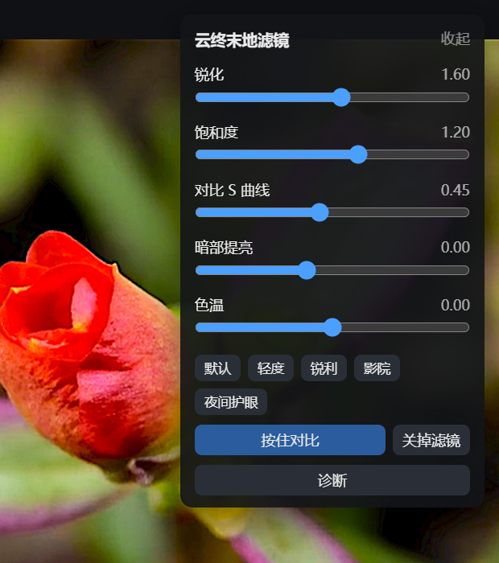
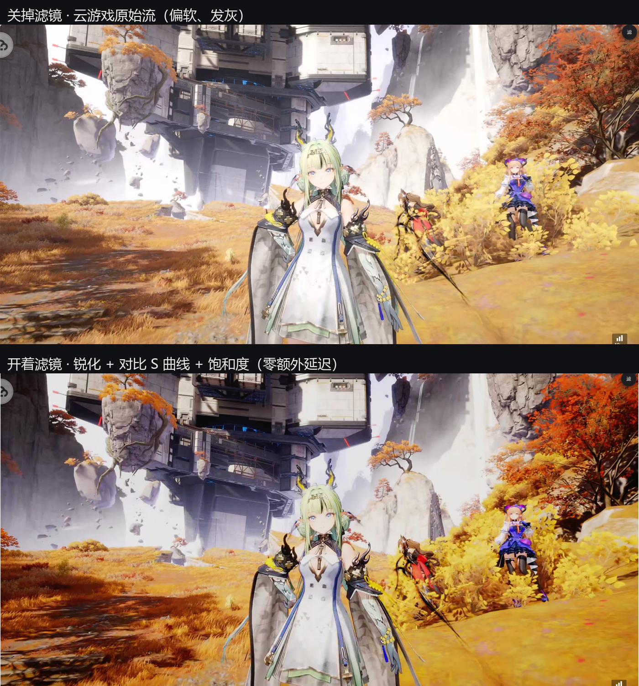

<p align="center">
  
</p>

<h1 align="center">Endfield Cloud Filter</h1>

<p align="center">
  A picture filter for the web version of <b>Arknights: Endfield</b> —
  <b>sharpen, contrast, saturation, shadow lift, color temperature</b>.<br />
  Everything is adjustable, there are five presets, and a hold-to-compare button shows you the difference instantly.<br />
  <i>It only changes how the picture is displayed — it does not read game data, does not modify any file, and does not connect to the internet.</i><br />
  Built by <b>DeepSeek</b>.
</p>

<p align="center">
  <a href="README.md">中文说明</a> | English Readme
</p>

<p align="center">
  <a href="LICENSE"></a>
  <a href="https://github.com/yuelary/endfield-cloud-filter/releases"></a>
  
</p>

<p align="center">
  <a href="https://raw.githubusercontent.com/yuelary/endfield-cloud-filter/main/endfield-cloud-filter.user.js">
    
  </a>
</p>

Everything is processed locally in your browser. Nothing goes through a server, and no extra latency is added.



## Features

- **Sharpen** — makes edges a bit clearer
- **Contrast (S-curve)** — takes away some of the flat, hazy look
- **Saturation** — colors a bit stronger or weaker
- **Shadow lift** — brightens dark areas
- **Color temperature** — shift the whole picture cooler or warmer
- **5 presets** — Default / Light / Sharp / Cinema / Night
- **Hold to compare** — hold the button to temporarily turn the filter off, release to turn it back on
- **Floating ball** — collapse the panel into a small ball you can drag anywhere; its position is remembered, click to expand
- **Per-site settings** — each site keeps its own values

Same scene, filter off and on:



## Install

### 1. Install a userscript manager

[Tampermonkey](https://microsoftedge.microsoft.com/addons/detail/iikmkjmpaadaobahmlepeloendndfphd),
[ScriptCat](https://microsoftedge.microsoft.com/addons/detail/scriptcat/liilgpjgabokdklappibcjfablkpcekh) or
Violentmonkey — Edge, Chrome and Firefox all work.

### 2. Install the script

Open this URL and your manager will show an install page:

```
https://raw.githubusercontent.com/yuelary/endfield-cloud-filter/main/endfield-cloud-filter.user.js
```

Or download the latest `endfield-cloud-filter.user.js` from
[Releases](https://github.com/yuelary/endfield-cloud-filter/releases) and drag it into a browser window.

### Other cloud gaming sites

Add one `@match` line at the top of the script, for example:

```js
// @match  *://cloud.example.com/*
```

## Usage

1. Enter the game — the panel appears in the top right corner
2. Drag the sliders, or click a preset
3. To check whether it does anything, hold the **Hold to compare** button

If the panel is in the way, click 收起 (collapse) to shrink it into a small ball you can drag aside. `Alt+G` also collapses and expands it.

## Two limitations

- **The panel is not visible in fullscreen** (the filter still applies) — adjust the settings in windowed mode first
- **If the game locks the mouse you cannot click the panel** — use `Alt+G`

## Privacy

- Does not read cookies or account information
- Does not make any external network request
- Sends no data by default (even local debug reports require manually setting `localStorage['cgf-debug'] = '1'`)

## Test data

Pause the picture on a single frame, take one screenshot with the filter off and one with it on, then compare them with OpenCV
(sharpness = Laplacian variance; higher means sharper):

| Area | Mean pixel difference | Pixels changed | Sharpness |
| --- | --- | --- | --- |
| Whole frame | 5.41 | 49.8% | 545 → 631 |
| video inside a shadow root | 6.94 | 63.6% | 171 → 304 |
| Plain video | 3.87 | 36.0% | 920 → 959 |

How to reproduce this is described below.

## Project layout

```
endfield-cloud-filter.user.js   The script itself (one file, directly installable)
README.md  README_en.md  LICENSE  CHANGELOG.md
AGENTS.md                       Notes for AI collaborators (including the pitfalls we hit)
docs/                           Screenshots · release notes · sharing copy
test/video-test.html            Test page
tools/serve.mjs                 Local static server for installing (127.0.0.1 only)
tools/cdp.mjs                   Debug helper: list / eval / inject / shot
.github/workflows/ci.yml        Syntax, metadata and version consistency checks
```

## Develop / verify it yourself

```bash
node --check endfield-cloud-filter.user.js    # syntax
node tools/ci-check.mjs                       # metadata / version / dependency checks
node tools/serve.mjs                          # local install page
```

To reproduce the test table above:

1. Start a Chromium with a debugging port (use a **separate** `--user-data-dir`, never your daily profile)
2. `node tools/cdp.mjs inject video-test endfield-cloud-filter.user.js`
3. Pause on a single frame, screenshot with the filter off and on, then compare `mean|Δ|` and Laplacian variance

## FAQ

**No panel in the game?**
Click 诊断 (diagnose) inside the panel: it lists the videos it found and whether the filter is attached. If the count is 0, the player lives in an iframe on another domain — add the matching `@match` line.

## License

MIT © 2026 yuelary

## How this was made

This project was built by **DeepSeek** (requirements and acceptance testing by yuelary).
The script is a single file with no minification and no obfuscation, so you can just open it and read it.
